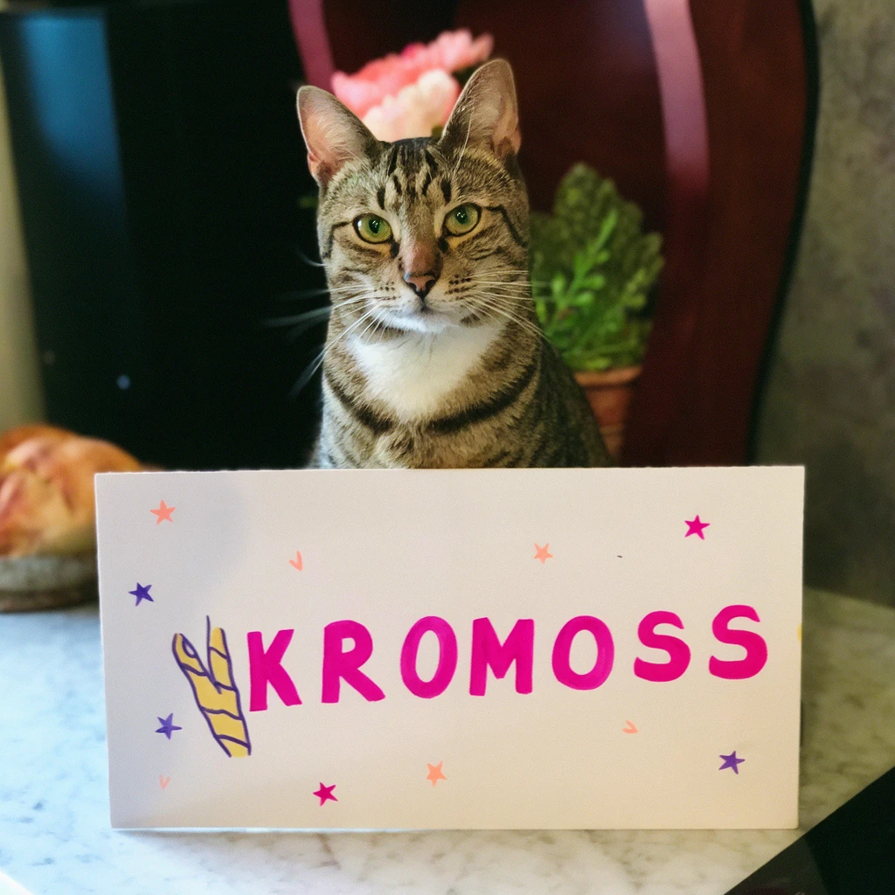

# Kromoss GGUF

This repository contains GGUF quantizations of [Kromoss](https://huggingface.co/lodestones/Kromoss), a full fine-tune of [MOSS-Image-Base](https://huggingface.co/OpenMOSS-Team/MOSS-Image-Base) at 1024 px. Kromoss uses the same architecture, text encoder and VAE as MOSS-Image-SFT, so it drops into the MOSS-Image workflows. The upstream model and conversion are based on the OpenMOSS release, which is licensed under Apache-2.0.

## Quantizations

File sizes are shown in GiB. Standard quants use common GGML formats. Proprietary quants use custom ConvRot formats supported by the `comfyui-gguf-reboot` loader nodes.

| Quant | Format | Size | File |
| --- | --- | ---: | --- |
| Q4_K_M | Standard GGUF | 3.35 GiB | [kromoss-Q4_K_M.gguf](https://huggingface.co/molbal/Kromoss-GGUF/blob/main/kromoss-Q4_K_M.gguf) |
| Q6_K | Standard GGUF | 4.24 GiB | [kromoss-Q6_K.gguf](https://huggingface.co/molbal/Kromoss-GGUF/blob/main/kromoss-Q6_K.gguf) |
| Q8_0 | Standard GGUF | 5.31 GiB | [kromoss-Q8_0.gguf](https://huggingface.co/molbal/Kromoss-GGUF/blob/main/kromoss-Q8_0.gguf) |
| Q8_CR | Proprietary, `comfyui-gguf-reboot` | 5.04 GiB | [kromoss-Q8_CR.gguf](https://huggingface.co/molbal/Kromoss-GGUF/blob/main/kromoss-Q8_CR.gguf) |
| Q4_CR_L | Proprietary, `comfyui-gguf-reboot` | 3.56 GiB | [kromoss-Q4_CR_L.gguf](https://huggingface.co/molbal/Kromoss-GGUF/blob/main/kromoss-Q4_CR_L.gguf) |

Standard GGUF files can be loaded with compatible GGUF tools. Q8_CR and Q4_CR_L use custom quantization layouts and require the `comfyui-gguf-reboot` loader nodes. They are not compatible with general-purpose GGUF loaders.

## ComfyUI setup

Install [comfyui-gguf-reboot](https://registry.comfy.org/publishers/molbal/nodes/comfyui-gguf-reboot). Use its `UnetLoaderGGUFDynamicVRAM` node to load a GGUF from `models/diffusion_models/`. These loader nodes give the best performance.

The workflow also needs the following upstream files:

| Component | File | ComfyUI folder |
| --- | --- | --- |
| Text encoder | [qwen3.5_9b_w4a8_gptq.safetensors](https://huggingface.co/Comfy-Org/MOSS-Image/resolve/main/text_encoders/qwen3.5_9b_w4a8_gptq.safetensors) | `models/text_encoders/` |
| VAE | [flux2-vae_small.safetensors](https://huggingface.co/Comfy-Org/MOSS-Image/resolve/main/vae/flux2-vae_small.safetensors) | `models/vae/` |

[Download the Kromoss ComfyUI workflow](https://huggingface.co/molbal/Kromoss-GGUF/blob/main/workflows/kromoss-t2i-gguf.json).

## Sampling settings

The supplied workflow uses the official Kromoss reference settings: 50 steps, CFG 3, euler sampler, sgm_uniform scheduler, and skip layer guidance on layer 22.

## Inputs and outputs

Kromoss accepts natural-language prompts, tag sequences, and JSON layouts that specify text and object placement. It generates a still image. The upstream pipeline requires image dimensions that are multiples of 16.

The upstream repository also ships 8-step turbo LoRAs: [lodestones/Kromoss](https://huggingface.co/lodestones/Kromoss).

## License and attribution

The upstream Kromoss model is released under the [Apache License 2.0](https://huggingface.co/lodestones/Kromoss/blob/main/LICENSE). See the [upstream model card](https://huggingface.co/lodestones/Kromoss) and the [OpenMOSS project](https://github.com/OpenMOSS/MOSS-Image) for model details.
