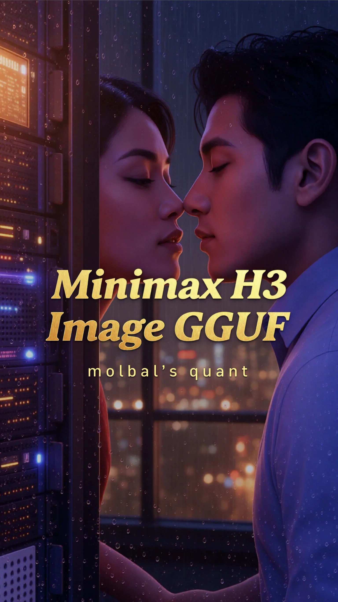

# MiniMax H3 Image GGUF

This repository contains GGUF quantizations of [MiniMax-H3-Image](https://huggingface.co/MiniMaxAI/MiniMax-H3-Image). The model generates images from text and edits one or more reference images with the same checkpoint.

It renders images of about 16 megapixels in 6 sampling steps without classifier-free guidance. It uses the MiniMax H3 text encoder, which is based on Qwen3-VL.

## Quantizations

| Quant | Format | Size | File |
| --- | --- | ---: | --- |
| Q4_K_M | Standard GGUF | 13.4 GiB | [minimax_h3_image-Q4_K_M.gguf](https://huggingface.co/molbal/miniMax-H3-Image-GGUF/blob/main/minimax_h3_image-Q4_K_M.gguf) |
| Q8_0 | Standard GGUF | 20.7 GiB | [minimax_h3_image-Q8_0.gguf](https://huggingface.co/molbal/miniMax-H3-Image-GGUF/blob/main/minimax_h3_image-Q8_0.gguf) |

Q8_0 keeps more detail. Use Q4_K_M when VRAM is tight.

## Inputs and outputs

Text-to-image takes a text prompt and an output size. Image editing takes a text prompt, one or more reference images, and an output size. Refer to reference images in the prompt as `<Picture 1>`, `<Picture 2>`, and so on.

Long prompts work better than short ones. Describe the subject, outfit, place, light, and framing. For a photo look, add camera words such as "shot on a phone front camera", "visible skin texture and pores", and "no retouching".

The working range is about 4 MP to 20 MP, and about 16 MP gives the best results. Common sizes are 4096 x 4096 (1:1), 4736 x 3552 (4:3), 5472 x 3072 (16:9), and 3552 x 4736 (3:4).

| Setting | Value |
| --- | --- |
| Steps | 6 |
| CFG | 1, no guidance branch needed |
| Sampler | SamplerLCM, s_noise 1.1 falling to 0.9 |
| Scheduler | simple |

## ComfyUI setup

Install [comfyui-gguf-reboot](https://registry.comfy.org/publishers/molbal/nodes/comfyui-gguf-reboot). Use its `UnetLoaderGGUFDynamicVRAM` node to load a GGUF from `models/diffusion_models/`. These loader nodes give the best performance.

The workflows also need the following upstream files:

| Component | File | ComfyUI folder |
| --- | --- | --- |
| Text encoder | [qwen3vl_32b_minimax_h3_nvfp4_awq.safetensors](https://huggingface.co/Comfy-Org/MiniMax-H3/resolve/main/text_encoders/qwen3vl_32b_minimax_h3_nvfp4_awq.safetensors) | `models/text_encoders/` |
| Image VAE | [minimax_h3_image_vae_fp16.safetensors](https://huggingface.co/Comfy-Org/MiniMax-H3-Image/resolve/main/vae/minimax_h3_image_vae_fp16.safetensors) | `models/vae/` |

The NVFP4 text encoder runs natively on RTX 50-series cards. On other cards, use [qwen3vl_32b_minimax_h3_int8_convrot.safetensors](https://huggingface.co/Comfy-Org/MiniMax-H3/resolve/main/text_encoders/qwen3vl_32b_minimax_h3_int8_convrot.safetensors) in the same folder.

[Download the text-to-image ComfyUI workflow](workflows/minimax_h3_image_t2i-gguf.json).

[Download the image edit ComfyUI workflow](workflows/minimax_h3_image_edit-gguf.json).

## License and attribution

The upstream MiniMax H3 Image model uses the [MiniMax H3 Image Community License Agreement](https://huggingface.co/MiniMaxAI/MiniMax-H3-Image/blob/main/LICENSE). This license differs from the MiniMax H3 license. You need separate written approval from MiniMax if your annual revenue is above 1 million USD or if you provide the model as a hosted service to third parties.
